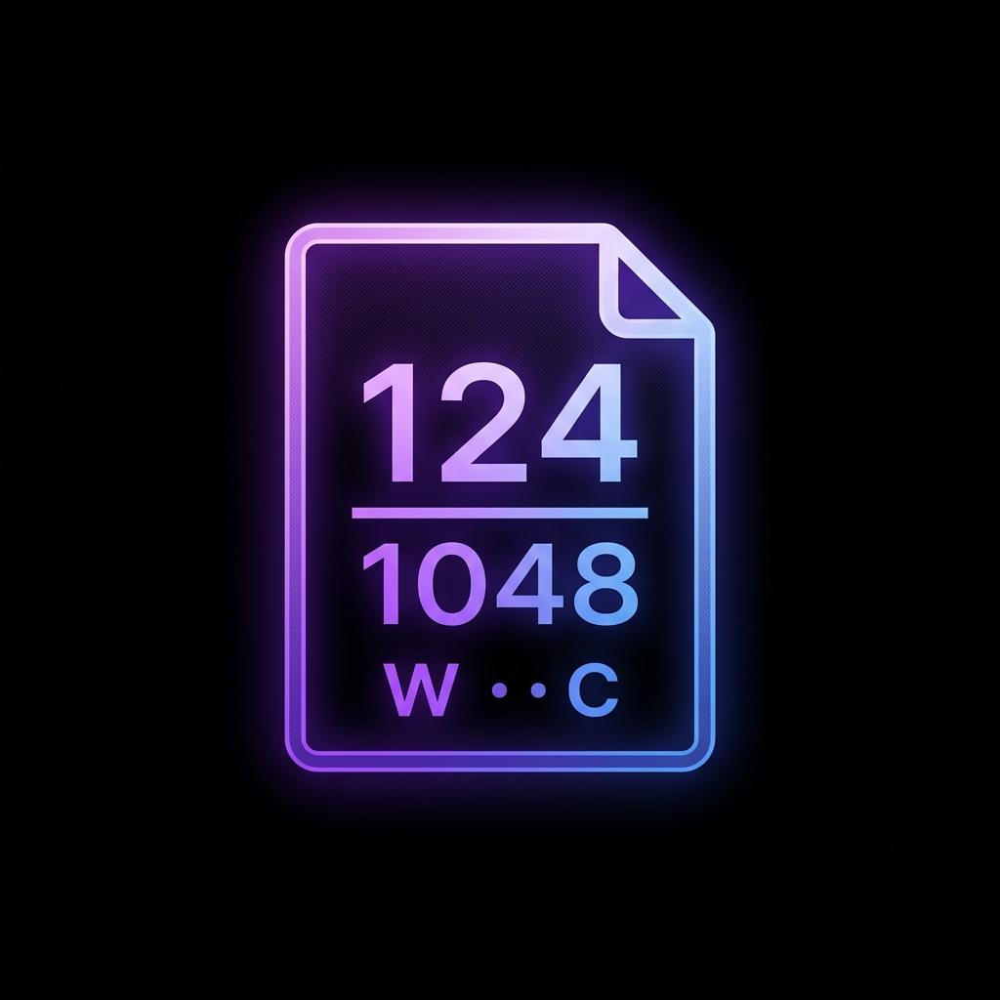

<div align="center">
  
</div>
<p align="center">
  <b>A minimalist, high-performance extension for Visual Studio that tracks your document's word and character count in real time.</b>
</p>
<div align="center">
  [](https://marketplace.visualstudio.com/items?itemName=Winstead-Inc.LiveCharactersandWordsCount)
  [](LICENSE.md)
</div>
---
## ✨ Features
- **Real-Time Tracking:** Instantly updates the word and character count as you type. 
- **Native UI Integration:** Injected directly into the Visual Studio status bar (bottom left, right beside the Git controls). It stays completely out of your main coding space.
- **Zero Performance Impact:** Built on modern asynchronous Visual Studio extensibility APIs (`IWpfTextViewCreationListener`). The background calculation never blocks your typing or slows down your IDE.
- **Minimalist Design:** Optimized specifically for dark mode and perfectly matches Visual Studio's native UI look and feel.
## 🚀 Installation
### Option 1: Visual Studio Marketplace (Recommended)
1. Open Visual Studio.
2. Go to **Extensions** > **Manage Extensions**.
3. Search for **Live Characters and Words Count** under the "Online" tab.
4. Click **Download**, restart Visual Studio, and you're good to go!
Alternatively, download it directly from the [Visual Studio Marketplace](https://marketplace.visualstudio.com/items?itemName=Winstead-Inc.LiveCharactersandWordsCount).
### Option 2: Manual Installation
1. Go to the [Releases](https://github.com/Winstead-Inc/Live-Characters-and-Words-Count/releases) tab.
2. Download the latest `.vsix` file.
3. Double-click the file to launch the VSIX Installer.
4. Restart Visual Studio.
## 🛠️ How it Works
Simply open any text, markdown, or code file in Visual Studio. Look at the bottom-left corner of your status bar to see a live updating counter formatted exactly like this:
`152 Words | 1328 Chars`
The extension taps into Visual Studio's text buffer events to efficiently recalculate the layout asynchronously without locking up your thread.
## ⚙️ Building from Source
To build this extension locally, you will need:
- **Visual Studio 2022** (or the Visual Studio 2026 Preview)
- **Visual Studio extension development workload** (Installable via the Visual Studio Installer)
1. Clone this repository:
   ```bash
   git clone https://github.com/Winstead-Inc/Live-Characters-and-Words-Count.git
   ```
2. Open `Live Characters and Words Count.slnx` in Visual Studio.
3. Set the build configuration to `Release`.
4. Press `Ctrl+Shift+B` to build.
5. Find the compiled `.vsix` extension inside the `bin\Release\net472` directory!
## 📜 License
This project is licensed under the **GNU General Public License v3.0 (GPL-3.0)** - see the [LICENSE.md](LICENSE.md) file for details.
---
*Created by [Winstead-Inc](https://github.com/Winstead-Inc).*
